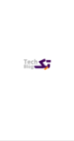
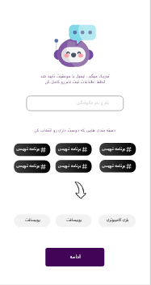
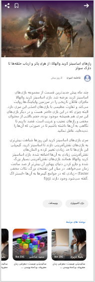
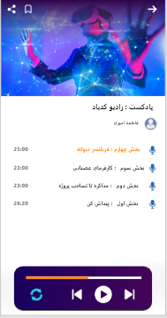
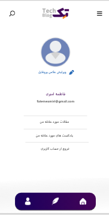

<p align="center">
  
</p>

<p align="center">
  
  
  
  
  
</p>

<h1 align="center">TechBlog — Persian Tech Publishing Platform</h1>

<p align="center">
  A full-featured Persian blog & CMS: <b>browse articles, choose categories, read, listen & manage content</b>.<br/>
  Clean GetX architecture, Dio networking, HTML rendering and RTL-native UX.
</p>

<p align="center">
  <a href="#-visual-tour-real-app-captures"><b>Visual Tour</b></a> •
  <a href="#-features">Features</a> •
  <a href="#-tech-stack">Tech Stack</a> •
  <a href="#-run-locally">Run Locally</a>
</p>

---

## ✨ Visual Tour — Real App Captures

> **6 actual Flutter screens** — purple TechBlog brand, dark hero, RTL editorial. Not mockups.

<p align="center">
  
  
  
  
</p>
<p align="center">
  
  
</p>

<p align="center"><sub>Top: Splash → Categories (انتخاب موضوع) → Home (فید) → Article (مقاله + جنگجو) • Bottom: Podcast player → Profile</sub></p>

<details>
<summary><b>📸 What you see</b></summary>
<br>

* **Splash (`splash.jpg`):** Minimal `Tech Blog` wordmark — clean entry.
* **Categories (`categories.jpg`):** Monster mascot 💬 + `تعیین دسته‌بندی مورد علاقه` + multi-select chips (`هوش مصنوعی`, `برنامه نویسی`, `بازی`...) + stage dots + `ادامه` purple CTA.
* **Home (`home.jpg`):** Purple `Tech Blog` header, hamburger menu, hero `مقاله برتر: دوازده قدم برنامه‌نویسی یک دو سه - ۲ روز پیش` over dual monitors, chips `مجا / ویدیو / پادکست`, `مشاهده داغ‌ترین نوشته‌ها` grid with colorful cubes + `ماشین لرنینگ` cards + `مشاهده برترین بلاگ‌ها` voice FAB.
* **Article (`article.jpg`):** Full-bleed fantasy warrior hero, title `رازهای اساس کار هارد، رم و رازها که درک نمی‌شود` + author `کورش رستمی`, long Persian body, tags `ویسکالت / بازی`, related `مقاله مرتبط` carousel at bottom + share/bookmark nav.
* **Podcast (`podcast.jpg`):** `پادکست: رادیو گیکاد` over VR metaverse hero, episode list (`بخش اول: دیلمان دیجو`), timestamps `23:00 + 23:00 + 26:20`, bottom audio player with progress, play/skip/loop.
* **Profile (`profile.jpg`):** `پروفایل شخصی` avatar, `فاطمه اسوری` `tatenasouri@gmail.com`, fields `مقالات من / مجموعه‌های من / رمز و ورود / خروج` + bottom nav (home/article/profile).

</details>

---

## 🚀 Features

- **Onboarding** — `ChooseCategories` screen with chip selection, persisted via `GetStorage`, `RegisterBinding`
- **Home Feed** — `HomeScreen` + `HomePage` with hero article, category filters, `ArticleListScreen` grid, cached images
- **Article Detail** — `ArticleInfoScreen` with `flutter_widget_from_html` rich Persian rendering, share (`share_plus` 7.2.1), bookmark, author follow
- **Authoring** — `ArticleManage` + `ArtilcePostInfo` with `file_picker` cover upload, GetX `ManageBinding` + `ArticleBinding`
- **Podcast** — Audio player UI (ready for `just_audio` plug-in), episode list with duration, play state
- **Auth & Profile** — `RegisterTechBlog` → choose categories → `ProfileScreen` with user data + local theme
- **Persian CMS DNA** — `Locale('fa','IR')`, `flutter_localizations` + `intl`, custom `MyColors` + `inputDecorationTheme` (rounded 20 + 45,180,230 border), RTL mirroring

## 🧱 Tech Stack

| Area | Stack |
|------|-------|
| **Core** | Flutter 2.19+, Dart, GetX 4.6.6 + GetStorage 2.1.1 |
| **Networking** | `dio` 5.3.3, `cached_network_image` 3.3.0 |
| **UI / Content** | `flutter_svg` 2.0.7, `flutter_spinkit` 5.2.0, `flutter_widget_from_html` 0.14.7, `share_plus` 7.2.1, `file_picker` 6.1.1, `url_launcher` 6.2.1 |
| **Localization** | `flutter_localizations`, `intl`, `validators` 3.0.0 |
| **Pattern** | GetX Bindings: `RegisterBinding` / `ArticleBinding` / `ManageBinding` / `FilePickerBinding` + `RoutePage` |

## 📂 Structure

```
lib/
├── view/
│   ├── splash_screen.dart
│   ├── choose_categories.dart
│   ├── register/register_techblog.dart
│   ├── main_screen/
│   │   ├── home_screen.dart
│   │   ├── home_page.dart
│   │   └── profile_screen.dart
│   └── article/
│       ├── article_info_screen.dart
│       ├── article_list_screen.dart
│       ├── article_manage.dart
│       └── article_post_info.dart
├── component/my_colors.dart   # SolidColors.statusBarColor etc.
├── common/
│   ├── binding.dart
│   └── route_page.dart
└── main.dart                  # GetStorage.init() → GetMaterialApp(Locale('fa','IR'))
```

## ▶️ Run Locally

```bash
git clone https://github.com/Muhammad1831/TechBlog.git
cd TechBlog
flutter pub get
flutter run -d chrome
flutter run -d android
```

No API keys needed — set Dio `baseUrl` in your `controller`/`service` when backend is ready. `file_picker` + `share_plus` work on web with fallback.

## 🎨 Design Notes

- **Palette:** Deep tech purple `#6366F1` + dark hero + white cards — editorial & premium
- **Typography:** Bold Persian headlines, 2-line clamped cards, purple CTA with rounded pills
- **States:** `flutter_spinkit` for loading, empty & error handled per GetX controller

## 🔜 Roadmap

- [ ] Offline article cache with Hive
- [ ] Push for new articles (FCM)
- [ ] Comments & likes

---

<p align="center">Built with Flutter 💙 by <a href="https://github.com/Muhammad1831">Muhammad Saleh</a> · Clean content, Persian-first</p>
<p align="center"><sub>6 actual implementation captures — no Figma mockups. Brand “Tech Blog” preserved.</sub></p>
